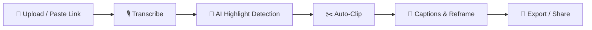

<div align="center">

<!-- ═══════════════════════════════════════════════════════════════════════ -->
<!--                              HERO                                      -->
<!-- ═══════════════════════════════════════════════════════════════════════ -->


<br/>

<a href="https://github.com/dadapeersy">
  
</a>
<a href="https://www.linkedin.com/in/dadapeer-yerimani-98b90a27a/">
  
</a>
<a href="mailto:yerimanid@gmail.com">
  
</a>
<a href="https://www.instagram.com/dadapeer__4321">
  
</a>

<br/><br/>


<br/><br/>


</div>

<br/>

<!-- ═══════════════════════════════════════════════════════════════════════ -->
<!--                           SYSTEM PROFILE                               -->
<!-- ═══════════════════════════════════════════════════════════════════════ -->

## ⟦ 01 ⟧  SYSTEM PROFILE


I'm a **Full Stack Developer** who builds modern, scalable web products and turns real business problems into working software.

I work across the entire product lifecycle: interface design, APIs, database architecture, authentication, deployment and performance. Lately I'm pushing into **AI-powered products** that automate work people used to do by hand.

```yaml
╭─ user ──────────────────────────────────────────────╮
  name:      Dadapeer Yerimani
  role:      Full Stack Developer
  location:  Karnataka, India
  status:    🟢 Online · Building

╭─ focus ─────────────────────────────────────────────╮
  - AI-Powered Web Applications
  - SaaS & Multi-tenant Platforms
  - CMS Platforms
  - CRM Systems
  - Business Dashboards

╭─ stack ─────────────────────────────────────────────╮
  frontend:  [Next.js, React, TypeScript, Tailwind CSS]
  backend:   [Node.js, Express.js, MongoDB, REST APIs]

╭─ loading ───────────────────────────────────────────╮
  - System Design
  - Cloud Architecture / AWS
  - AI Integration
  - Scalable Backend Architecture
```

<br clear="right"/>

<div align="center">

</div>

<br/>

<!-- ═══════════════════════════════════════════════════════════════════════ -->
<!--                            CAPABILITIES                                -->
<!-- ═══════════════════════════════════════════════════════════════════════ -->

## ⟦ 02 ⟧  CAPABILITIES

<div align="center">

|      ⚡ MODULE      | 🔨 WHAT I BUILD                                              |
| :----------------: | :----------------------------------------------------------- |
|      **SaaS**      | Multi-tenant platforms and business applications             |
|       **CMS**      | Custom content management and website platforms              |
|       **CRM**      | Lead management, assignment, activities and sales workflows  |
|   **Dashboards**   | Admin panels, analytics and internal business tools          |
|    **AI Tools**    | AI video pipelines, automation and developer tools           |
|    **Web Apps**    | Production-ready Next.js applications                        |
|  **Architecture**  | Authentication, APIs, databases and scalable systems         |

</div>

<br/>

<!-- ═══════════════════════════════════════════════════════════════════════ -->
<!--                              TECH STACK                                -->
<!-- ═══════════════════════════════════════════════════════════════════════ -->

## ⟦ 03 ⟧  TECH ARSENAL

<div align="center">

**`// FRONTEND`**


<br/><br/>

**`// BACKEND & DATABASE`**


<br/><br/>

**`// TOOLS`**


</div>

<br/>

<div align="center">

</div>

<br/>

<!-- ═══════════════════════════════════════════════════════════════════════ -->
<!--                            FEATURED WORK                               -->
<!-- ═══════════════════════════════════════════════════════════════════════ -->

## ⟦ 04 ⟧  FEATURED PROJECTS

<br/>

<div align="center">

### 🎬 AI CLIPPER &nbsp;`NEW`


</div>

An **AI-powered video clipping platform** that turns long-form videos (podcasts, interviews, streams, webinars) into short, shareable clips automatically, so creators spend their time creating instead of editing.



**Highlights**

* Upload a video or paste a link to start a clip job
* Automatic speech-to-text transcription
* AI-driven detection of the most engaging moments
* Auto-generated short clips with start/end timestamps
* Animated captions and vertical (9:16) reframing for Shorts / Reels / TikTok
* Background job queue for heavy video processing
* Clean dashboard to preview, trim and download clips
* Authentication and per-user project history

**Stack:** `Next.js` `React` `TypeScript` `Node.js` `MongoDB` `FFmpeg` `AI / LLM APIs`

<br/>

<div align="center">

### 🏗️ FULL-STACK CMS & WEBSITE PLATFORM

</div>

A platform designed to manage multiple client websites from a centralized dashboard.

**Highlights**

* Multi-project architecture
* Custom website themes
* Content and media management
* Component-based editing
* Authentication & authorization
* SEO management
* MongoDB data architecture
* Cloud image management
* Production deployments

**Stack:** `Next.js` `React` `TypeScript` `Node.js` `MongoDB` `Tailwind CSS`

<br/>

<div align="center">

### 📊 CRM & LEAD MANAGEMENT PLATFORM

</div>

A business CRM focused on managing sales leads and automating salesperson workflows.

**Highlights**

* Lead management with role-based access
* Automated lead assignment and round-robin distribution
* Salesperson working hours
* Lead activity history and audit trail
* Quotation workflows
* Server-side pagination
* SWR-based data fetching
* MongoDB aggregation

**Stack:** `Next.js` `React` `TypeScript` `MongoDB` `SWR`

<br/>

<div align="center">

### ⚙️ BUSINESS DASHBOARDS

</div>

Internal dashboards that bring business operations into one place:

`Orders & Purchase Orders` · `Customers` · `Products` · `Vendors` · `Quotations` · `Employees` · `CRM Workflows` · `Calendar Systems` · `Media Libraries` · `Website Configuration`

<br/>

<div align="center">

</div>

<br/>

<!-- ═══════════════════════════════════════════════════════════════════════ -->
<!--                              GITHUB STATS                              -->
<!-- ═══════════════════════════════════════════════════════════════════════ -->

## ⟦ 05 ⟧  TELEMETRY

<div align="center">


<br/>


</div>

<br/>

<div align="center">

</div>

<br/>

<!-- ═══════════════════════════════════════════════════════════════════════ -->
<!--                          CURRENTLY LEARNING                            -->
<!-- ═══════════════════════════════════════════════════════════════════════ -->

## ⟦ 06 ⟧  UPGRADE PATH

<div align="center">

```text
┌─────────────────────────────┐
│        SYSTEM DESIGN        │
└──────────────┬──────────────┘
               ▼
┌─────────────────────────────┐
│    SCALABLE ARCHITECTURE    │
└──────────────┬──────────────┘
               ▼
┌─────────────────────────────┐
│    CLOUD INFRASTRUCTURE     │
└──────────────┬──────────────┘
               ▼
┌─────────────────────────────┐
│     DISTRIBUTED SYSTEMS     │
└──────────────┬──────────────┘
               ▼
┌─────────────────────────────┐
│        AI INTEGRATION       │
└──────────────┬──────────────┘
               ▼
┌─────────────────────────────┐
│    PRODUCTION ENGINEERING   │
└─────────────────────────────┘
```

</div>

I'm particularly interested in **how applications scale beyond the code itself**: architecture, databases, caching, authentication, performance, deployment and infrastructure.

<br/>

<div align="center">

</div>

<br/>

<!-- ═══════════════════════════════════════════════════════════════════════ -->
<!--                               2026 GOALS                               -->
<!-- ═══════════════════════════════════════════════════════════════════════ -->

## ⟦ 07 ⟧  MISSION OBJECTIVES · 2026

<div align="center">

| STATUS | OBJECTIVE |
| :----: | :-------- |
| 🟢 | Build and ship more production-ready SaaS products |
| 🟢 | Launch **AI Clipper** and build more practical AI-powered apps |
| 🟡 | Become stronger in system design and software architecture |
| 🟡 | Deepen AWS and cloud infrastructure knowledge |
| 🟡 | Improve application performance and scalability |
| 🟡 | Learn more about production security |
| 🔵 | Contribute to open-source projects |
| 🔵 | Work on impactful real-world products |

<sub>🟢 In progress &nbsp;·&nbsp; 🟡 Learning &nbsp;·&nbsp; 🔵 Planned</sub>

</div>

<br/>

<div align="center">

</div>

<br/>

<!-- ═══════════════════════════════════════════════════════════════════════ -->
<!--                          DEVELOPMENT PHILOSOPHY                        -->
<!-- ═══════════════════════════════════════════════════════════════════════ -->

<div align="center">

## ⟦ 08 ⟧  CORE PROTOCOL

<br/>

### `BUILD  →  UNDERSTAND  →  IMPROVE  →  SCALE`

<br/>

Good software is more than making something work.<br/>
It's about understanding **why it works, how it can fail, how it can scale, and how it can be improved.**

</div>

<br/>

<div align="center">

</div>

<br/>

<!-- ═══════════════════════════════════════════════════════════════════════ -->
<!--                                CONNECT                                 -->
<!-- ═══════════════════════════════════════════════════════════════════════ -->

<div align="center">

## ⟦ 09 ⟧  OPEN CHANNEL

<br/>

**Building interesting products** &nbsp;•&nbsp; **Collaborating on projects** &nbsp;•&nbsp; **Discussing software architecture**

**Exploring AI + web development** &nbsp;•&nbsp; **Learning new technologies** &nbsp;•&nbsp; **Solving hard engineering problems**

<br/>

<a href="https://www.linkedin.com/in/dadapeer-yerimani-98b90a27a/">
  
</a>
<a href="mailto:yerimanid@gmail.com">
  
</a>

<br/><br/>

### ⭐ If you find something useful in my repositories, consider giving it a star.

<br/>


</div>
